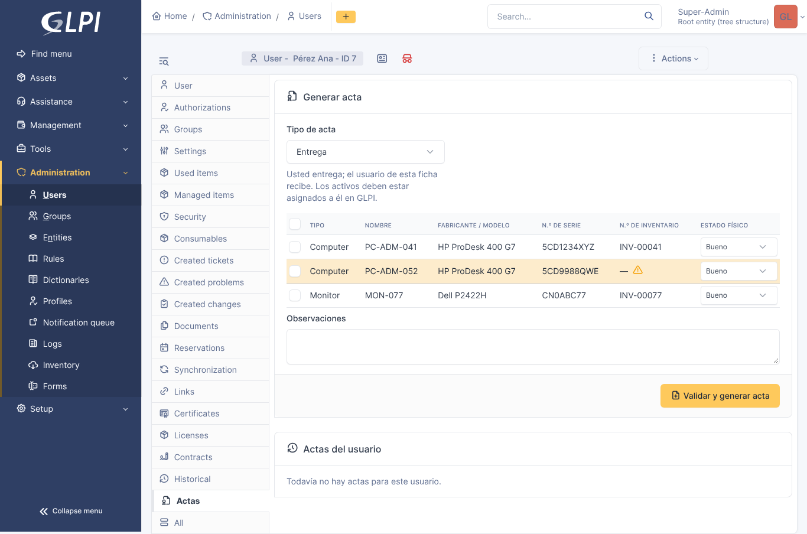

# Actas de entrega para GLPI

Plugin para **GLPI 11** que genera actas de **entrega, devolución y traslado** de activos tecnológicos a partir del inventario, con tres garantías que no ofrecen las alternativas existentes:

1. **Consistencia antes de generar.** El acta no se genera si el inventario no coincide: el activo debe estar asignado en GLPI a la persona correcta y tener número de serie y número de inventario.
2. **Integridad verificable.** Cada acta lleva una huella SHA-256 de su contenido, impresa en el PDF junto con un código QR que abre una página pública de verificación.
3. **Inmutabilidad.** Un acta generada no se modifica ni se elimina: solo se marca como firmada o se anula indicando el motivo. Todo queda en una bitácora.

Proyecto de grado — Programa de Ingeniería de Software, Universidad de Cartagena (2026-2).



## Funcionalidades

| Funcionalidad | Dónde |
|---|---|
| Pestaña **Actas** en la ficha del usuario: activos asignados, generación y actas previas | Administración › Usuarios › *usuario* › Actas |
| Validación de consistencia inventario-acta (asignación, campos obligatorios, duplicados) | Al pulsar «Validar y generar acta» |
| Actas de entrega (AE-), devolución (AD-) y traslado (AT-) con consecutivo anual por tipo | Formulario de la pestaña |
| PDF con texto real, tabla de activos, firmas, huella SHA-256 y QR | Guardado en Gestión › Documentos y vinculado al acta, a las personas y a cada activo |
| Copia (snapshot) de los datos del activo en el momento del acta | El acta conserva lo entregado aunque el inventario cambie |
| Estados: generada → firmada → anulada (con motivo obligatorio) | Ficha del acta |
| Verificación de integridad interna y pública (sin sesión, datos mínimos) | Ficha del acta / `front/verificar.php` |
| Pestaña **Actas** en la ficha de cada activo: historial de movimientos | Activos › *activo* › Actas |
| Listado y búsqueda de actas | Herramientas › Actas de entrega |
| Derechos por perfil: leer, generar, firmar/anular (no existe el derecho de borrar) | Administración › Perfiles › *perfil* › Actas de entrega |

## Requisitos

- GLPI 11.0.x (probado en 11.0.11)
- PHP 8.2 o superior
- MySQL 8 / MariaDB 10.5 o superior (las de la instancia de GLPI)
- Sin dependencias externas: el PDF y el QR usan la biblioteca TCPDF que ya incluye GLPI.

## Instalación

```bash
cd /ruta/de/glpi/plugins
git clone https://github.com/respanat/actasentrega.git actasentrega
```

La carpeta **debe llamarse `actasentrega`**. Luego, en GLPI: **Configuración › Complementos › Actas de entrega › Instalar › Activar**.
O por consola:

```bash
php bin/console plugin:install actasentrega --username=glpi
php bin/console plugin:activate actasentrega
```

El perfil Super-Admin recibe todos los derechos. Para otros perfiles: **Administración › Perfiles › *perfil* › Actas de entrega**.

### Ambiente de pruebas con Docker

```bash
docker compose up -d     # GLPI 11.0.11 + MariaDB 10.11 en http://localhost:8080
```

## Uso

1. En GLPI, asigne los activos al usuario (campo **Usuario** de cada activo).
2. Abra la ficha del usuario › pestaña **Actas**.
3. Elija el tipo de acta, marque los activos, indique su estado físico y pulse **Validar y generar acta**.
4. Si algo no cuadra con el inventario, el plugin lo explica y no genera nada. Si todo cuadra, abre la ficha del acta con su PDF.
5. Cuando tenga la copia firmada, márquela como **firmada**. Si hubo un error, **anúlela** con el motivo y genere una nueva.

| Tipo | Entrega | Recibe | Regla de consistencia |
|---|---|---|---|
| Entrega | Técnico que genera | Usuario de la ficha | El activo ya está asignado al usuario en GLPI |
| Devolución | Usuario de la ficha | Técnico que genera | El activo sigue asignado al usuario en GLPI |
| Traslado | Custodio anterior | Usuario de la ficha | El activo ya fue reasignado al usuario en GLPI |

## Cómo funciona la huella

El plugin construye un **contenido canónico** del acta (número, tipo, fecha, entidad, personas, observaciones y los datos de cada activo, con claves y activos ordenados) y calcula su SHA-256. Esa huella:

- se imprime en el PDF y va dentro del QR;
- se guarda en la base de datos junto con el contenido canónico;
- se recalcula al verificar. Si alguien altera el PDF, la cabecera o los activos en la base de datos, la verificación lo detecta.

La huella **prueba integridad, no autoría**: no reemplaza una firma digital certificada (Ley 527 de 1999, arts. 6 a 8).

## Pruebas

```bash
composer install
composer test                         # PHPUnit
php tests/tools/mini-runner.php       # sin Composer ni internet
```

Resultados y casos de integración en [docs/pruebas.md](docs/pruebas.md).

## Documentación

- [Requisitos](docs/requisitos.md)
- [Arquitectura y modelo de datos](docs/arquitectura.md)
- [Comparativa con complementos existentes](docs/comparativa.md)
- [Pruebas](docs/pruebas.md)

## Estructura

```
actasentrega/
├── setup.php            versión, requisitos, registro de pestañas, menú y ruta pública
├── hook.php             instalación y desinstalación (tablas y derechos)
├── src/
│   ├── ActaBuilder.php  lógica de dominio pura: validación, consecutivo, contenido canónico, huella
│   ├── Acta.php         modelo (CommonDBTM): generación, inmutabilidad, estados, verificación, vistas
│   ├── ActaItem.php     activos del acta (snapshot) e historial en la ficha del activo
│   ├── PdfRenderer.php  PDF con TCPDF, huella y QR
│   └── Profile.php      pestaña de derechos en el perfil
├── front/               acta.php (listado), acta.form.php (acciones), verificar.php (público)
├── templates/           vistas Twig
├── tests/               PHPUnit + mini-runner
└── docs/                requisitos, arquitectura, comparativa, pruebas, capturas
```

## Licencia

GPL-3.0-or-later. Ver [LICENSE](LICENSE).

## Autor y soporte

Ramiro Alfonso España Tejada — reporte errores o sugerencias en [Issues](https://github.com/respanat/actasentrega/issues).
