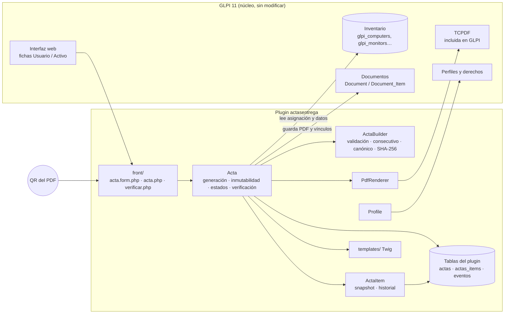
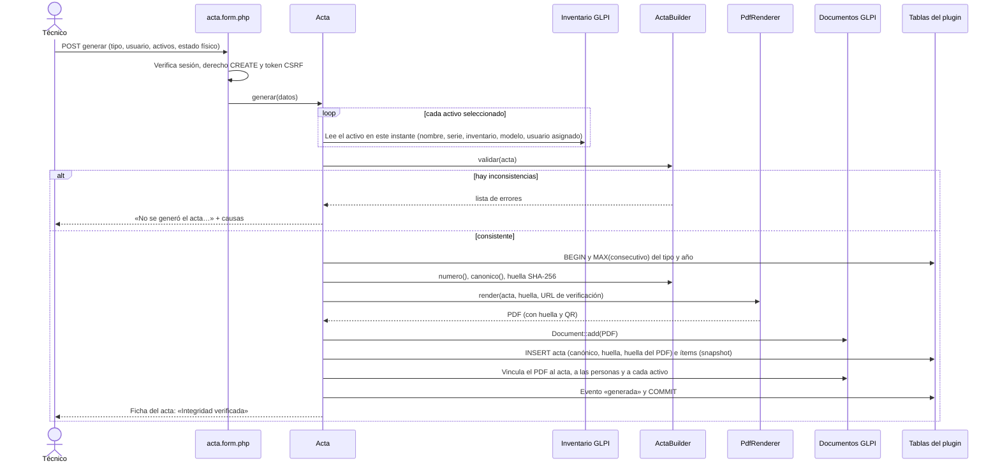
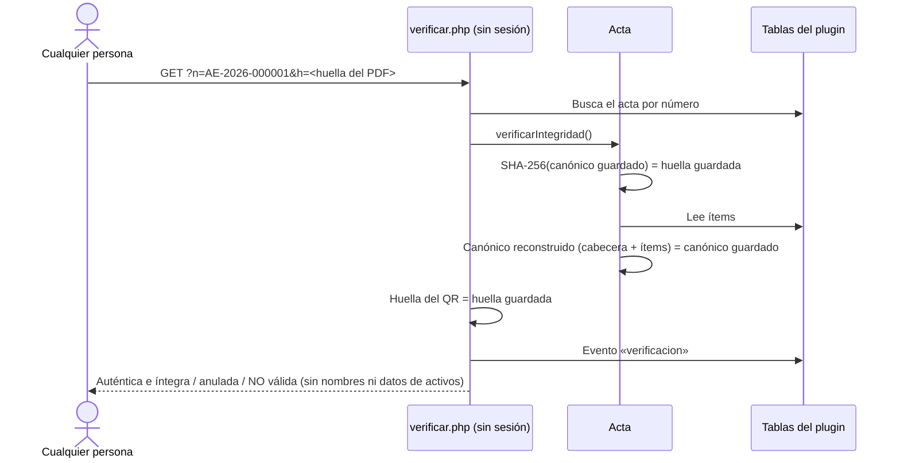
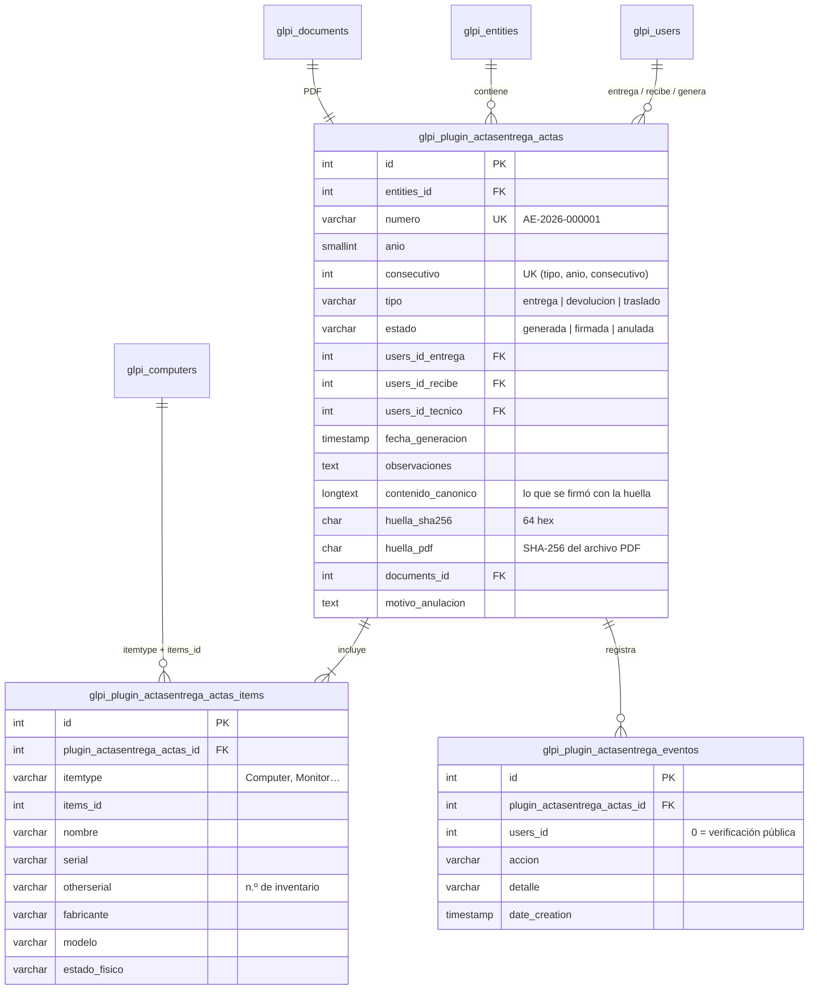
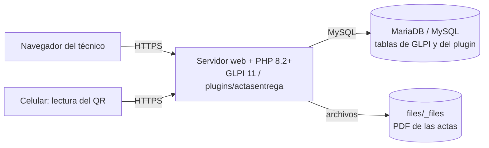

# Arquitectura

El plugin sigue la estructura de la [guía oficial de desarrollo de complementos de GLPI](https://glpi-developer-documentation.readthedocs.io/en/master/plugins/) (Teclib'), con una organización compatible con MVC:

- **Modelo:** `src/` (clases que heredan de `CommonDBTM`) y la lógica de dominio pura `ActaBuilder`.
- **Controlador:** `front/` (puntos de entrada que GLPI 11 carga mediante su controlador de scripts heredados).
- **Vista:** `templates/` (Twig, mediante `TemplateRenderer`).

`ActaBuilder` no depende de GLPI: valida, numera, construye el contenido canónico y calcula la huella. Por eso se prueba de forma aislada.

## Diagrama de componentes

## Diagrama de secuencia: generación del acta

## Diagrama de secuencia: verificación pública (QR)

## Modelo de datos

## Despliegue

## Decisiones de diseño

| Decisión | Alternativa descartada | Motivo |
|---|---|---|
| Inmutabilidad en la capa de modelo (`prepareInputForUpdate`, `pre_deleteItem`) | Disparadores en la base de datos | Muchos servidores no conceden el privilegio TRIGGER; la verificación de integridad detecta además cualquier cambio hecho por fuera de GLPI |
| Guardar el contenido canónico además de la huella | Recalcular solo desde las tablas | Los nombres de las personas pueden cambiar en GLPI; el canónico conserva exactamente lo que se firmó |
| Snapshot de los activos | Leer el inventario actual al mostrar el acta | El acta debe reflejar lo entregado, no el estado actual del activo |
| TCPDF de GLPI | dompdf u otra biblioteca | Evita dependencias nuevas y conflictos de versiones con el núcleo |
| Página de verificación pública con datos mínimos | Verificación solo con sesión | Quien recibe una copia del acta (auditoría, otra dependencia) puede comprobarla sin usuario de GLPI; la Ley 1581 obliga a minimizar los datos expuestos |
| Consecutivo por tipo y año con clave única | Contador en tabla de configuración | La clave única impide duplicados aun con generaciones simultáneas |
