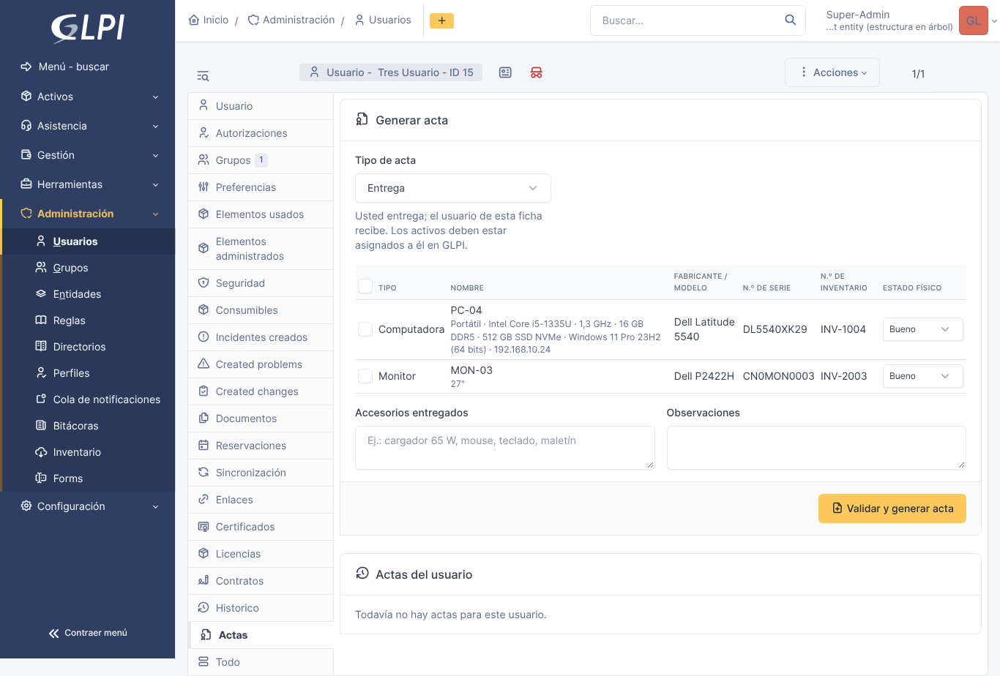
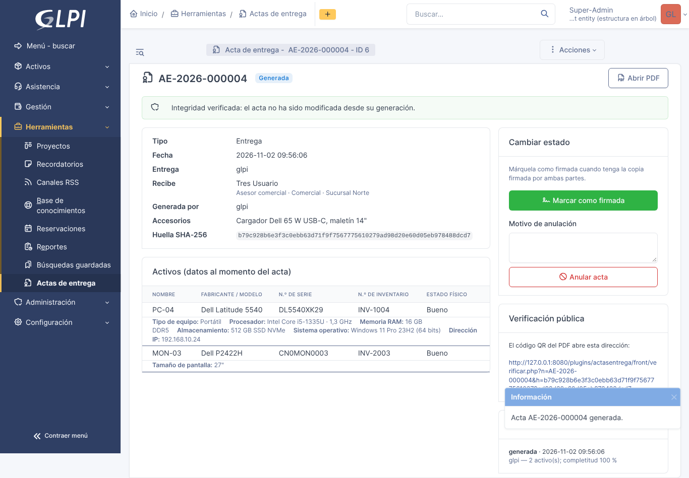
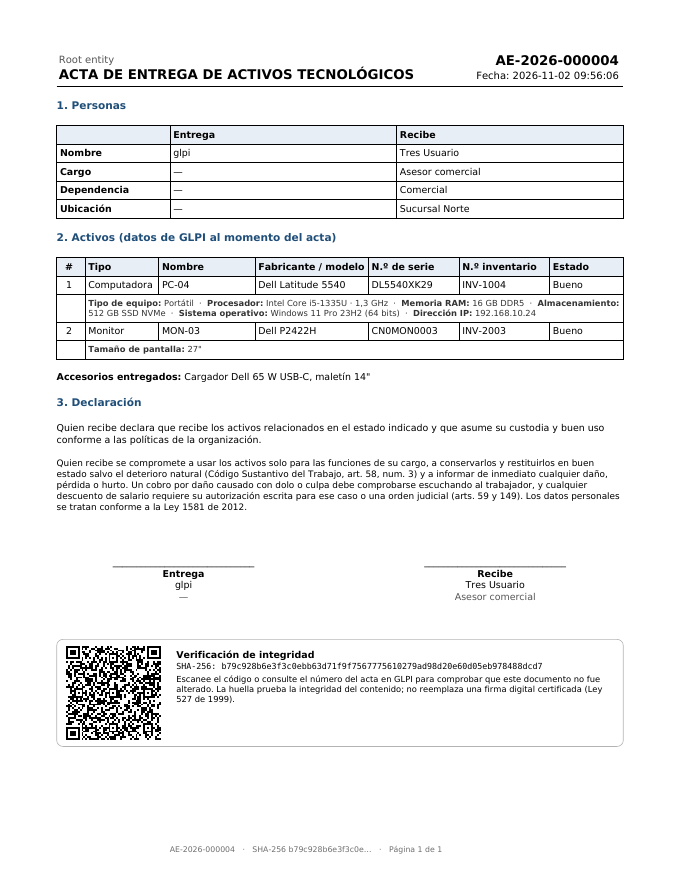
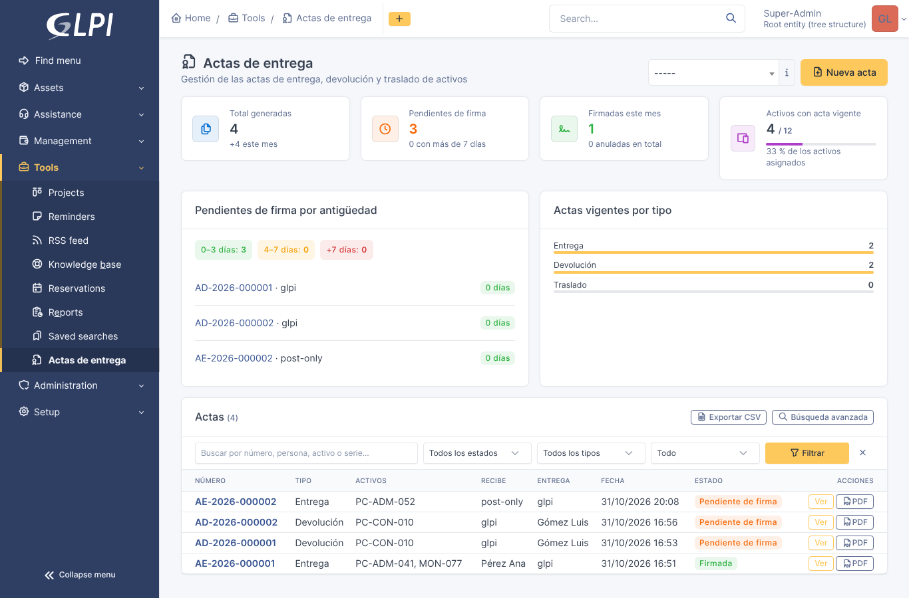
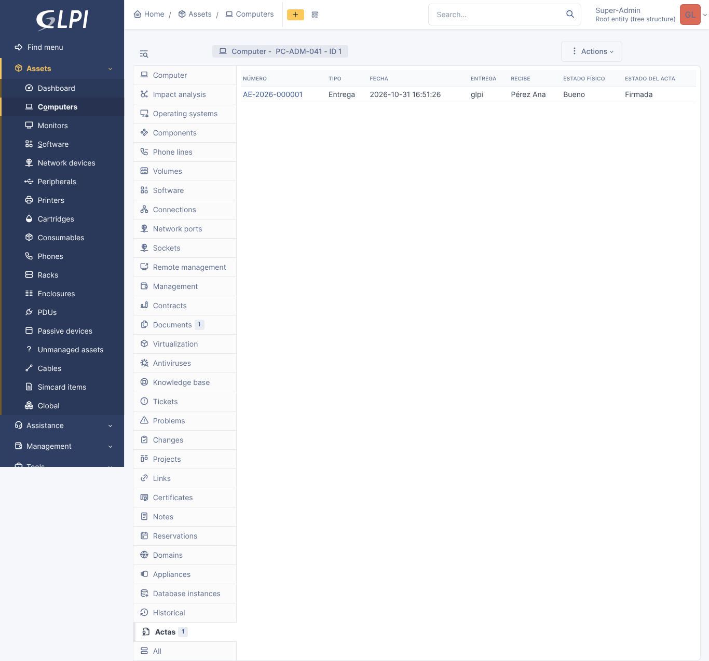
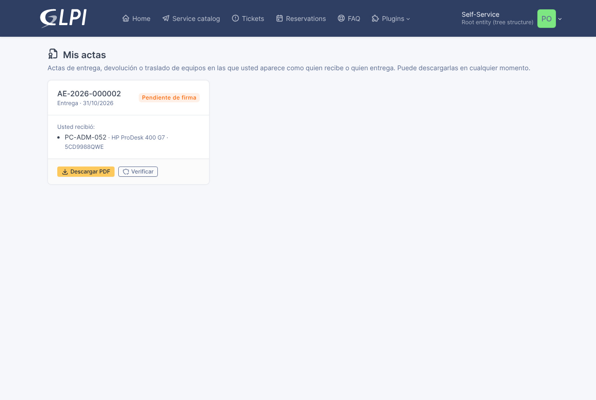

# Manual de usuario — Actas de entrega para GLPI

Versión 1.0.0 · GLPI 11.0.x

Este manual explica cómo generar, firmar, anular, consultar y verificar actas de entrega, devolución y traslado de activos tecnológicos con el complemento **Actas de entrega** para GLPI. Para instalarlo, consulte la [Guía de instalación](guia_instalacion.md).

## 1. Conceptos básicos

**Acta.** Documento que formaliza que un activo pasa de una persona a otra. El complemento maneja tres tipos, cada uno con su prefijo y su consecutivo anual:

| Tipo | Prefijo | Quién entrega | Quién recibe | Condición en GLPI |
|---|---|---|---|---|
| Entrega | AE- | Técnico que genera el acta | Usuario de la ficha | El activo ya está asignado al usuario |
| Devolución | AD- | Usuario de la ficha | Técnico que genera el acta | El activo sigue asignado al usuario |
| Traslado | AT- | Custodio anterior | Usuario de la ficha | El activo ya fue reasignado al usuario |

**Validación de consistencia.** Antes de generar, el complemento compara lo que se va a entregar con el inventario de GLPI. Si un activo no está asignado a la persona correcta, no tiene número de serie o de inventario, o está repetido, el acta **no se genera** y se explica la causa. El inventario es la fuente de verdad: primero se corrige en GLPI y luego se genera el acta.

**Huella de integridad.** Cada acta tiene una huella SHA-256 calculada sobre su contenido. La huella se imprime en el PDF y va dentro del código QR. Si alguien altera el contenido, la verificación lo detecta. La huella prueba **integridad, no autoría**: la firma sigue siendo manuscrita.

**Inmutabilidad.** Un acta generada no se puede editar ni borrar. Solo cambia de estado: **generada → firmada**, o **anulada** con un motivo obligatorio. Todo queda en la bitácora del acta.

## 2. Permisos

El administrador asigna los derechos en **Administración › Perfiles › *perfil* › Actas de entrega**:

| Derecho | Permite |
|---|---|
| Leer | Ver actas, el panel de gestión y la pestaña de actas de usuarios y activos |
| Generar | Generar actas desde la ficha del usuario |
| Firmar / anular | Marcar actas como firmadas o anularlas |

No existe un derecho para borrar actas. Cada usuario, aunque no tenga ninguno de estos derechos, puede ver y descargar **sus propias** actas desde **Mis actas**.

## 3. Generar un acta

1. **Asigne los activos en GLPI.** Abra cada activo (por ejemplo, *Activos › Computadores › equipo*) y, en el campo **Usuario**, seleccione a quien recibe. En un traslado, reasigne el activo al nuevo custodio antes de generar.
2. **Abra la ficha del usuario.** *Administración › Usuarios › usuario*, pestaña **Actas**. Verá los activos asignados con sus especificaciones técnicas y las actas anteriores.
3. **Elija el tipo de acta** (entrega, devolución o traslado). En un traslado, indique también el custodio anterior.
4. **Marque los activos** que incluye el acta e indique el **estado físico** de cada uno (Nuevo, Bueno, Regular o Malo).
5. **Registre los accesorios** entregados (cargador, mouse, maletín, etc.) y las **observaciones** que correspondan.
6. Pulse **Validar y generar acta**.

Si algo no coincide con el inventario, el complemento muestra un mensaje con la causa, por ejemplo: *«El activo PC-0142 está asignado a otra persona en GLPI»*. Corrija el dato en GLPI y repita el paso 6.

Si todo coincide, el complemento:

- asigna el número consecutivo (por ejemplo, `AE-2026-000015`);
- guarda una copia de los datos de cada activo en ese instante;
- calcula la huella y genera el **PDF**, que queda guardado en *Gestión › Documentos* y vinculado al acta, a las personas y a cada activo;
- abre la **ficha del acta**.

## 4. La ficha del acta

La ficha muestra el número, el tipo, el estado, las personas, los activos con su estado físico y especificaciones, los accesorios, la huella, el resultado de la verificación de integridad y la **bitácora** con cada cambio de estado.

Desde la ficha puede:

- **Descargar el PDF** para imprimirlo y recoger las firmas.
- **Marcar como firmada**, cuando tenga la copia física firmada por ambas partes.
- **Anular**, si el acta tiene un error. El motivo es obligatorio. Después genere un acta nueva con los datos correctos: el número anulado no se reutiliza.

## 5. El documento PDF

El PDF incluye el encabezado con el número y la fecha, los datos de quien entrega y quien recibe (nombre, cargo, dependencia y ubicación), la tabla de activos con sus especificaciones y estado físico, los accesorios, las observaciones, los espacios para las firmas, la huella SHA-256 y el código QR de verificación.

## 6. Verificar un acta

Cualquier persona puede comprobar un acta impresa sin iniciar sesión en GLPI: basta con leer el código QR con la cámara del celular. La página de verificación muestra uno de estos resultados:

| Resultado | Significado |
|---|---|
| **Acta auténtica e íntegra** | El acta existe, la huella impresa coincide con la registrada y el contenido no ha cambiado |
| **Acta íntegra, pero ANULADA** | El acta existió y no fue alterada, pero se anuló: no tiene validez |
| **Acta NO válida** | La huella del documento no coincide con la registrada o el contenido fue alterado; se indica el motivo |

Por protección de datos (Ley 1581 de 2012), la página pública no muestra nombres ni datos de los activos: solo el número, el tipo, la fecha, el estado y la cantidad de activos. Cada verificación queda registrada en la bitácora del acta.

Dentro de GLPI, la ficha del acta también recalcula la huella y muestra si el contenido guardado sigue íntegro.

## 7. Panel de gestión

En **Herramientas › Actas de entrega** encontrará:

- **Indicadores**: total de actas generadas (y cuántas este mes), pendientes de firma, firmadas este mes, anuladas y **cobertura**, es decir, el porcentaje de activos asignados que tienen un acta que respalde su entrega.
- **Pendientes de firma por antigüedad**: 0 a 3 días, 4 a 7 días y más de 7 días, para hacer seguimiento.
- **Listado** con búsqueda por texto y filtros por estado, tipo y periodo, con **exportación a CSV** de lo filtrado.

## 8. Historial del activo

En la ficha de cada activo, la pestaña **Actas** muestra todas las actas en las que ha estado: quién lo entregó, quién lo recibió, cuándo y en qué estado físico. Así se reconstruye la cadena de custodia del equipo.

## 9. Mis actas (autogestión)

Cada usuario de la interfaz simplificada encuentra sus actas en **Plugins › Actas de entrega** (**Mis actas**). Puede ver su estado y descargar el PDF. No ve las actas de otras personas.

## 10. Preguntas frecuentes

**¿Puedo corregir un acta ya generada?** No. Anúlela con el motivo y genere una nueva. Así se conserva la trazabilidad de lo que se emitió.

**El complemento no me deja generar el acta. ¿Qué hago?** Lea el mensaje: indica qué activo y qué dato no coincide. Corrija la asignación, el número de serie o el número de inventario en GLPI y vuelva a intentar.

**¿La huella reemplaza la firma?** No. Prueba que el contenido no cambió, pero la firma de las partes sigue siendo manuscrita sobre el PDF impreso.

**¿Qué pasa con las actas antiguas si el inventario cambia?** Nada. Cada acta guarda una copia de los datos del activo en el momento en que se generó y se sigue verificando con ellos.

**¿Dónde se guarda el PDF?** En *Gestión › Documentos*, vinculado al acta, a las personas y a cada activo.

## 11. Soporte

Consulte [SOPORTE.md](../SOPORTE.md).
